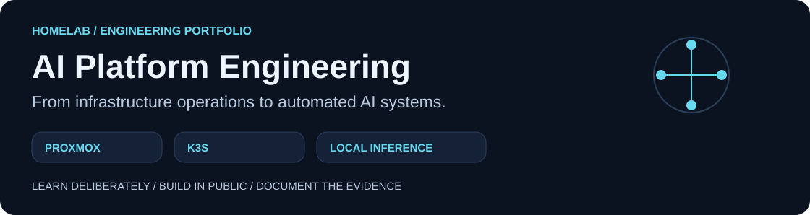
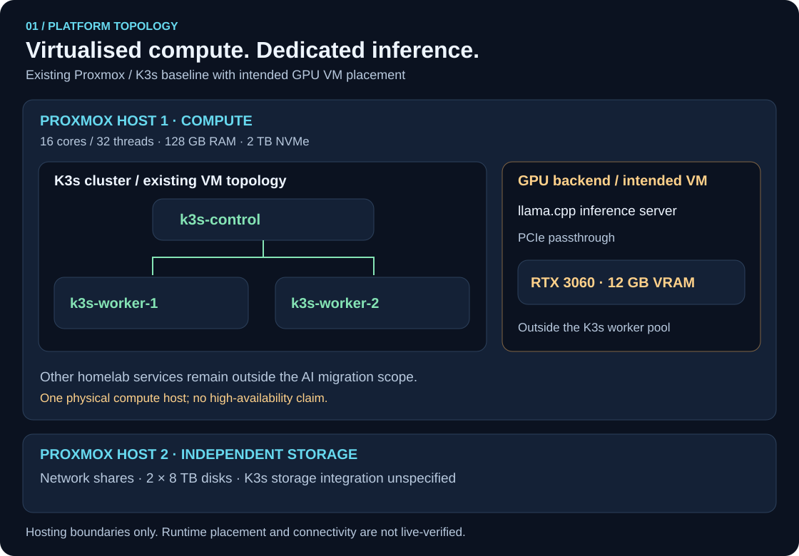
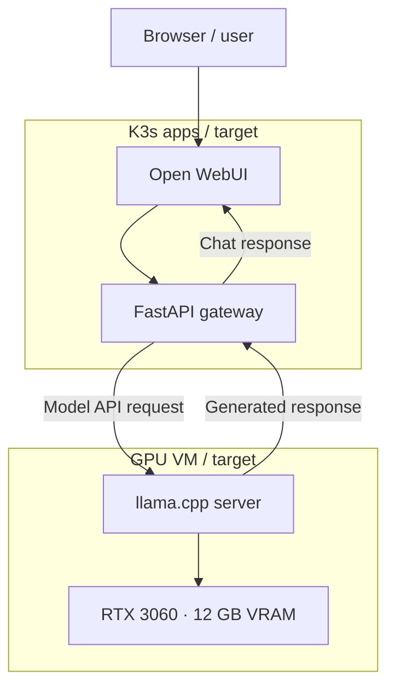
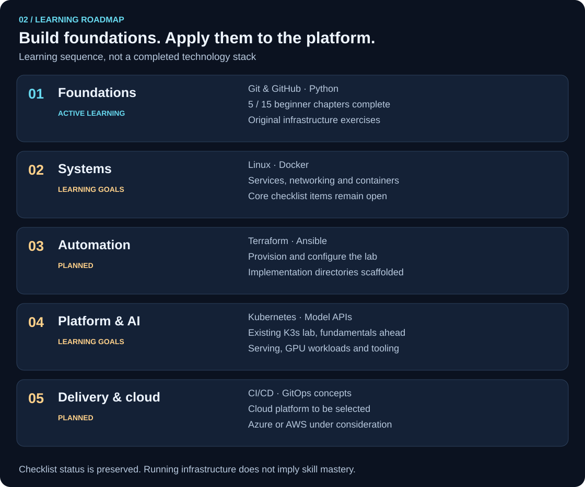

# AI Platform Engineering

**A hands-on portfolio by Will Holtom** · Infrastructure Operations → Platform Engineering → AI Infrastructure

Building the knowledge to design, automate and operate an AI platform on a Proxmox homelab.
This repository documents the learning, original Python labs and architecture behind that journey.

[Architecture](#platform-architecture) · [Practical labs](#practical-labs) · [Learning progress](#learning-progress) · [Roadmap](#learning-roadmap) · [Repository guide](#repository-guide)

> **Portfolio in development.** Proxmox and a three-node K3s cluster are already part of the homelab.
> Infrastructure automation, deployment manifests and operational evidence are still being built out.
> Running a technology does not mean its learning checklist is complete.

## Start here

| Explore | What it demonstrates |
| --- | --- |
| [Python labs](python/labs/) | Original exercises applying Python concepts to infrastructure scenarios |
| [Boot.dev notes](python/bootdev/) | Learning notes from five completed beginner chapters |
| [Architecture and assumptions](docs/architecture/README.md) | Hosting boundaries, intended inference flow and implementation gaps |
| [Diagram sources](docs/diagrams/README.md) | Editable Mermaid diagrams and reproducible SVG assets |
| [Learning log](docs/learning-log.md) | Dated learning entries; the current chapter statuses are below |

## Platform architecture

The Proxmox and K3s topology is an existing homelab baseline. The dedicated GPU VM is the
intended inference placement; this view does not certify the current deployment or connectivity.
The storage host is independent: no K3s persistent-volume integration is implied.

| Layer | Role | Evidence / status |
| --- | --- | --- |
| Proxmox VE | Virtual infrastructure for the lab | Existing homelab; provisioning code is planned |
| K3s | One control-plane VM and two worker VMs | Existing cluster; fundamentals remain on the learning roadmap |
| AI applications | Open WebUI and FastAPI | Target integration shown below; manifests are not yet committed |
| GPU inference | Dedicated backend using an RTX 3060 and llama.cpp | Intended VM placement; runtime configuration is not versioned here |
| Automation | Terraform, Ansible and CI/CD | Planned; directories currently provide scaffolding |

### Target AI request flow

The following is a **proposed integration**, not a claim that this exact route is deployed.
The GPU backend stays outside the K3s worker pool. FastAPI is the intended gateway in this design;
Open WebUI can also be configured differently, so deployed settings must be documented separately.

[Hosting topology and design limitations](docs/architecture/README.md) · [Editable inference source](docs/diagrams/src/inference.mmd)

## Practical labs

These small programs use example values to practise Python. They do not query live infrastructure.

| Lab | Concepts | Run from the repository root |
| --- | --- | --- |
| [Infrastructure Status Report](python/labs/infrastructure-status/) | Variables, data types and f-strings | `python3 python/labs/infrastructure-status/status_report.py` |
| [Cluster Readiness](python/labs/cluster-readiness/) | Comparisons, boolean logic and conditionals | `python3 python/labs/cluster-readiness/cluster_readiness.py` |

Both labs use the Python standard library. Practising a concept in a lab does not automatically
mark the corresponding structured-learning topic complete.

## Learning progress

**Current focus: Boot.dev DevOps Engineer path → Learn Python for Beginners.**

Course chapter completion and topic checklist completion measure different things.
The existing statuses below are preserved; the next unstarted chapter is **06 — Computing**.

| Chapter | Status |
|---|---|
| 01 - Introduction | ✅ Complete |
| 02 - Variables | ✅ Complete |
| 03 - Functions | ✅ Complete |
| 04 - Scope | ✅ Complete |
| 05 - Testing & Debugging | ✅ Complete |
| 06 - Computing | ⬜ Not Started |
| 07 - Comparisons | ⬜ Not Started |
| 08 - Loops | ⬜ Not Started |
| 09 - Lists | ⬜ Not Started |
| 10 - Dictionaries | ⬜ Not Started |
| 11 - Sets | ⬜ Not Started |
| 12 - Errors | ⬜ Not Started |
| 13 - Type Hints | ⬜ Not Started |
| 14 - Practice | ⬜ Not Started |
| 15 - Quiz | ⬜ Not Started |

[Course notes](python/bootdev/) · [Applied Python work](python/README.md)

## Learning roadmap

The visual roadmap groups the learning areas; the detailed checklist below is the source of truth.
Unchecked items remain learning goals, including technologies already running in the homelab.

<strong>Open the full learning checklist</strong>

### Git & GitHub

- [x] Core Git Fundamentals
- [ ] Branching
- [ ] Merge Conflicts
- [ ] Pull Requests
- [ ] GitHub Actions
- [ ] CI/CD Workflows

---

### Python

#### Python fundamentals

Currently being completed through Boot.dev.

- [x] Variables & Data Types
- [x] Functions
- [x] Scope
- [ ] Comparisons
- [ ] Conditionals
- [ ] Loops
- [ ] Lists
- [ ] Dictionaries
- [ ] Sets
- [ ] Error Handling
- [ ] Type Hints
- [x] Testing & Debugging

#### Python for Infrastructure

- [ ] File Handling
- [ ] JSON
- [ ] HTTP Requests
- [ ] REST APIs
- [ ] Virtual Environments
- [ ] Python Packaging
- [ ] Logging
- [ ] Environment Variables
- [ ] API Authentication

#### Python for Platform Engineering

- [ ] FastAPI
- [ ] Proxmox API
- [ ] Docker SDK
- [ ] Kubernetes Python Client
- [ ] Infrastructure Automation
- [ ] Monitoring / Health Check Tools

#### Python for AI Infrastructure

- [ ] AI Model APIs
- [ ] OpenAI-compatible APIs
- [ ] Local Model APIs
- [ ] Model Serving Automation
- [ ] GPU Workload Automation
- [ ] AI Platform Tooling

---

### Linux

- [ ] Linux Fundamentals
- [ ] Filesystem & Permissions
- [ ] Users & Groups
- [ ] Processes
- [ ] Networking
- [ ] Services / systemd
- [ ] Package Management
- [ ] Logging
- [ ] Bash / Shell Scripting
- [ ] Linux Troubleshooting

---

### Docker & Containers

- [ ] Container Fundamentals
- [ ] Images
- [ ] Dockerfiles
- [ ] Volumes
- [ ] Networking
- [ ] Docker Compose
- [ ] Container Security
- [ ] Container Troubleshooting

---

### Kubernetes

#### Kubernetes fundamentals

- [ ] Kubernetes Architecture
- [ ] Control Plane
- [ ] Worker Nodes
- [ ] Pods
- [ ] Deployments
- [ ] ReplicaSets
- [ ] Services
- [ ] Namespaces
- [ ] ConfigMaps
- [ ] Secrets
- [ ] Storage
- [ ] Ingress
- [ ] Resource Requests & Limits
- [ ] Health Probes

#### Platform Engineering

- [ ] Helm
- [ ] RBAC
- [ ] Network Policies
- [ ] Observability
- [ ] Persistent Storage
- [ ] GPU Workloads
- [ ] Application Deployment
- [ ] Kubernetes Troubleshooting
- [ ] Upgrade Strategy
- [ ] High Availability Concepts

---

### Terraform

- [ ] HCL Fundamentals
- [ ] Providers
- [ ] Resources
- [ ] Variables
- [ ] Outputs
- [ ] State
- [ ] Modules
- [ ] Proxmox Provider
- [ ] VM Provisioning
- [ ] Infrastructure Automation

---

### Ansible

- [ ] YAML Fundamentals
- [ ] Inventory
- [ ] Playbooks
- [ ] Variables
- [ ] Templates
- [ ] Roles
- [ ] Idempotency
- [ ] Linux Configuration
- [ ] Kubernetes Node Configuration

---

### CI/CD

- [ ] GitHub Actions
- [ ] Automated Testing
- [ ] Linting
- [ ] Build Pipelines
- [ ] Container Builds
- [ ] Security Scanning
- [ ] Deployment Pipelines
- [ ] GitOps Concepts

---

### Cloud

Future learning will include at least one major cloud platform.

Potential focus:

- Azure
- AWS

Topics will include:

- Compute
- Networking
- Identity
- Storage
- Infrastructure as Code
- Kubernetes
- Monitoring
- Security

## Repository guide

| Path | Purpose | Current contents |
| --- | --- | --- |
| [`python/`](python/) | Learning notes and original infrastructure labs | Active work |
| [`docs/architecture/`](docs/architecture/) | Platform context, boundaries and assumptions | Architecture overview |
| [`docs/diagrams/`](docs/diagrams/) | Mermaid sources, SVG generator and assets | Portfolio visuals |
| [`docs/decisions/`](docs/decisions/) | Future architecture decision records | Scaffold |
| [`docs/notes/`](docs/notes/) | Future technical notes | Scaffold |
| [`terraform/`](terraform/) | Planned VM provisioning and reusable modules | Scaffold |
| [`ansible/`](ansible/) | Planned configuration management | Scaffold |
| [`kubernetes/`](kubernetes/) | Planned manifests, services, ingress and Helm work | Scaffold |
| [`scripts/`](scripts/) | Future operational utilities | Scaffold |
| [`.github/workflows/`](.github/workflows/) | Future CI/CD workflows | Scaffold; no pipeline claimed |

## Learning approach

This repository separates **having technology running** from **understanding and deliberately learning that technology**.

For example, I already operate a Kubernetes environment in my homelab, but Kubernetes will remain an active learning area until I have worked through the fundamentals and demonstrated that knowledge through this repository.

For each major topic I aim to:

1. Learn the core concepts.
2. Document them in my own words.
3. Complete original exercises.
4. Apply the concepts to infrastructure-related scenarios.
5. Use the technology in my homelab.
6. Automate or improve the environment where appropriate.
7. Commit meaningful progress to GitHub.

## About me

I currently work as an **Infrastructure Operations Engineer (Compliance)** supporting enterprise infrastructure, including restricted and air-gapped environments.

My existing experience includes:

- Windows Server Administration
- Microsoft SCCM / MECM
- WSUS
- VMware vSphere / ESXi
- Proxmox VE
- Tenable.sc Vulnerability Management
- Server Compliance & Patch Management
- Enterprise Infrastructure Support
- Infrastructure Troubleshooting
- PowerShell Automation
- Networking Fundamentals

I am currently developing the skills required to move towards:

- DevOps Engineering
- Platform Engineering
- AI Platform Engineering

My main areas of development are:

- Python
- Linux
- Git & GitHub
- Docker
- Kubernetes
- Terraform
- Ansible
- CI/CD
- Cloud Platforms
- AI Infrastructure
- GPU-based AI workloads
