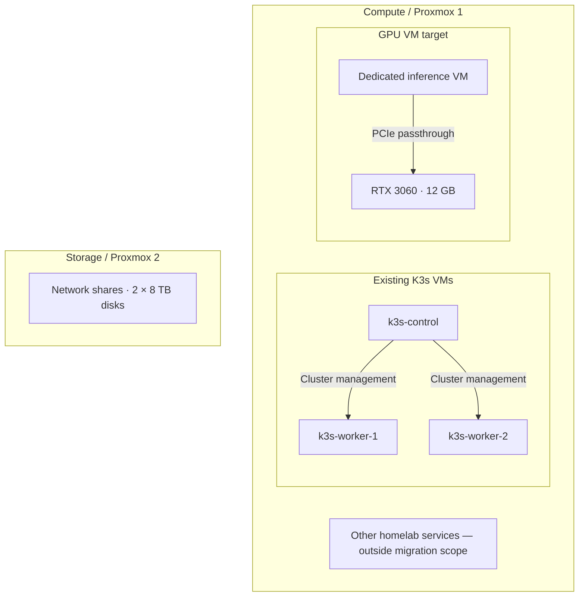
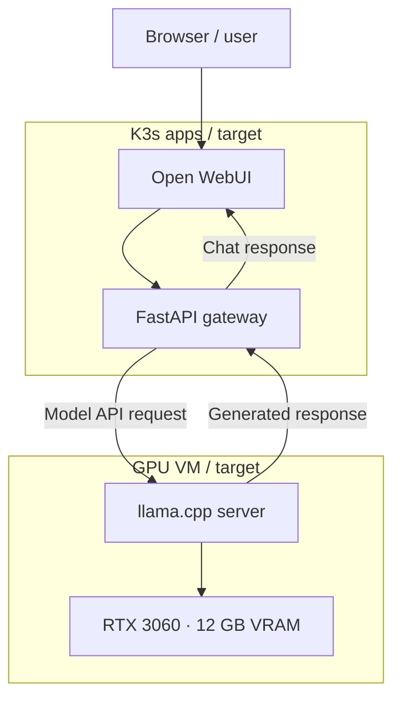

# Platform architecture

## Scope and evidence

This is a learning homelab, with an AI Platform Engineering target architecture.
The original repository README establishes Proxmox and a working K3s cluster with
`k3s-control`, `k3s-worker-1` and `k3s-worker-2`. Hardware and the intended dedicated
GPU VM placement come from the owner's homelab design supplied for this portfolio.
No live hosts were inspected for this documentation change.

The repository currently contains Python learning work and infrastructure scaffolding.
It does not yet contain reproducible Terraform, Ansible or Kubernetes deployments.
The diagrams describe hosting boundaries and intended integration, not verified uptime.

## Hosting boundaries

- **Compute host:** Proxmox VE; 16 cores / 32 threads, 128 GB RAM and 2 TB NVMe.
- **K3s cluster:** one control-plane VM and two worker VMs on the compute host.
- **GPU backend:** intended dedicated VM with RTX 3060 PCIe passthrough, running llama.cpp outside K3s. Earlier experiments used an LXC; the repository does not establish the current runtime placement.
- **Storage host:** separate Proxmox host with network shares and two 8 TB disks. No Kubernetes storage driver or persistent-volume integration is claimed.
- **Migration scope:** AI services only. Other homelab services remain outside this work.

## Target inference integration

A browser uses Open WebUI. In this proposed design, Open WebUI sends model requests
through a FastAPI gateway to a llama.cpp server on the GPU VM. The gateway forwards
responses to the UI. Exact endpoints, streaming behaviour, authentication and model
configuration remain to be documented and tested.

## Design limitations and work ahead

| Area | Current boundary | Evidence to add as the work is completed |
| --- | --- | --- |
| Availability | One control plane; all K3s VMs share one physical compute host | Failure and recovery notes; no HA claim |
| GPU capacity | One GPU backend; no redundancy shown | Model fit, latency, throughput and concurrency measurements |
| Provisioning | Infrastructure directories are scaffolds | Terraform plans and reproducible VM definitions |
| Configuration | Runtime configuration is not versioned here | Ansible playbooks and deployment instructions |
| Application routing | Inference flow is a target design | Manifests, service endpoints and an end-to-end request test |
| Storage | Independent network shares; K3s integration unspecified | Persistence design, backup and restore exercise |
| Security | Public exposure and trust controls are unspecified | Authentication, secrets handling and network access decisions |
| Operations | No observability or CI/CD implementation claimed | Health checks, dashboards and pipeline evidence |

These are documentation goals, not new completed learning milestones.

## Diagram maintenance

Edit the [Mermaid sources and SVG generator](../diagrams/README.md) alongside this
page when the design changes. Keep proposed behaviour explicitly labelled until
configuration and verification evidence are committed.
